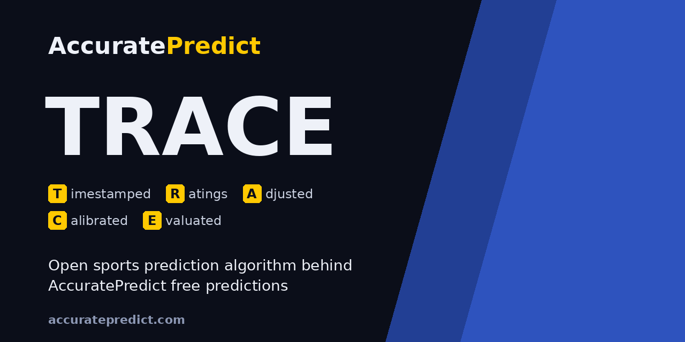
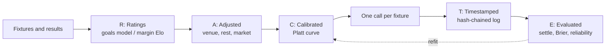

<p align="center">
  <a href="https://accuratepredict.com">
    
  </a>
</p>

# AccuratePredict TRACE: Sports Prediction Algorithm

**An open, auditable sports and football prediction algorithm: Timestamped, Ratings, Adjusted, Calibrated, Evaluated.**

[](LICENSE)
[](pyproject.toml)
[](pyproject.toml)
[](https://github.com/accuratepredict/accuratepredict-trace-sports-prediction-algorithm/actions/workflows/tests.yml)

TRACE is the framework behind the free football and multi-sport predictions on
[AccuratePredict.com](https://accuratepredict.com). This repository is its open
reference implementation. It shows how every probability on the site is
produced, adjusted, checked and recorded, in plain Python with no dependencies,
so anyone can read it, run it and judge the method for themselves.

It is a skeleton, not the production engine. The structure and the methods are
real. The tuned parameters, the data pipeline and the production models stay
private. See [What is not in this repository](#what-is-not-in-this-repository).

- **Free predictions, the method and the live record:** [accuratepredict.com](https://accuratepredict.com)

---

## Contents

- [Why TRACE exists](#why-trace-exists)
- [The five stages](#the-five-stages)
- [Quick start](#quick-start)
- [What the demo shows](#what-the-demo-shows)
- [Using TRACE in your own project](#using-trace-in-your-own-project)
- [What is not in this repository](#what-is-not-in-this-repository)
- [FAQ](#faq)
- [Support the project](#support-the-project)
- [Citing TRACE](#citing-trace)
- [About AccuratePredict](#about-accuratepredict)

## Why TRACE exists

Most prediction sites publish a tip and a confident adjective. A probability
forecast should be held to a higher standard: it should be stated before the
event, impossible to edit afterwards, and judged against what actually
happened over many results. TRACE is built around that standard.

| | Stage | What it does |
|---|---|---|
| **T** | Timestamped | Every call is saved before kick off. Updates are new versions, never edits, and the log is hash-chained so tampering is detectable. |
| **R** | Ratings | Each team or fighter has a strength rating built from settled results, weighted towards recent form. |
| **A** | Adjusted | Ratings are adjusted for the fixture: venue, rest and, where prices exist, the bookmaker market with its margin removed. |
| **C** | Calibrated | A stated 60 percent should win about 60 percent of the time. Systematic over or under confidence is measured and corrected. |
| **E** | Evaluated | Every call is settled by set rules and scored with proper scoring rules against simple baselines. Nothing is removed. |

## The five stages



| Module | Stage | Method |
|---|---|---|
| [`timestamp.py`](accuratepredict_trace/timestamp.py) | T | Append-only JSON Lines log, version per update, SHA-256 hash chain, "last version before kick off" settlement rule |
| [`ratings/goals.py`](accuratepredict_trace/ratings/goals.py) | R | Attack and defence strengths with time decay (Maher 1982), Poisson scores with the Dixon and Coles (1997) low-score correction. Prices 1X2, totals and both teams to score from one score table |
| [`ratings/elo.py`](accuratepredict_trace/ratings/elo.py) | R | Margin-aware Elo for points sports, normal margin model, optional draw band, between-season regression |
| [`adjust.py`](accuratepredict_trace/adjust.py) | A | Capped rest adjustment, proportional de-vig of decimal odds, weighted model and market blend |
| [`calibrate.py`](accuratepredict_trace/calibrate.py) | C | Two-parameter Platt scaling on log-odds, penalised towards "no change", inactive below a minimum sample |
| [`evaluate.py`](accuratepredict_trace/evaluate.py) | E | Settlement rules (1X2, totals with pushes, BTTS), Brier score, log loss, reliability table |
| [`picks.py`](accuratepredict_trace/picks.py) | | One named call per fixture, with a probability floor and a ceiling so nothing is presented as certain |

## Quick start

No install, no API key and no data licence needed. The demo generates a
synthetic league.

```bash
git clone https://github.com/accuratepredict/accuratepredict-trace-sports-prediction-algorithm.git
cd accuratepredict-trace-sports-prediction-algorithm
python examples/walk_forward_demo.py
python -m unittest discover -s tests
```

Or install it as a package:

```bash
pip install git+https://github.com/accuratepredict/accuratepredict-trace-sports-prediction-algorithm.git
```

## What the demo shows

`examples/walk_forward_demo.py` replays a full synthetic season one round at a
time. Before each round the model is fitted only on earlier results, so it can
never see the future. Each call is published to the hash-chained log, settled
when the "match" ends, and the season is scored at the end.

Typical output:

```text
SYNTHETIC DATA. These numbers describe a generated league, not any
real competition and not AccuratePredict's published record.

Match result, multi-class Brier score (lower is better)
  model        0.5966
  market       0.5911
  home_always  1.1089

Reliability (stated vs observed)
  0.6-0.7  n=151  stated 0.650  observed 0.550
  0.7-0.8  n=117  stated 0.746  observed 0.650

Calibration curve fitted on 377 calls: a=0.700 b=-0.101
  a stated 0.60 becomes 0.546

Prediction log: 377 records, chain intact
```

Two lessons are built in on purpose. A well-informed market is hard to beat,
so the model is blended with it rather than set against it. And a raw model
is usually overconfident at the top end, which is exactly what the
calibration stage is there to find and fix.

## Using TRACE in your own project

```python
from datetime import date
from accuratepredict_trace import GoalsModel, blend_with_market, PlattCalibrator, choose_call

results = [  # (date, home, away, home_goals, away_goals)
    (date(2025, 8, 16), "Northbridge", "Eastvale", 2, 1),
    # ... more settled results
]
model = GoalsModel(half_life_days=180).fit(results, as_of=date(2026, 1, 10))
markets = model.markets("Northbridge", "Eastvale")
markets["1X2"] = blend_with_market(markets["1X2"],
                                   {"home": 2.10, "draw": 3.40, "away": 3.60},
                                   model_weight=0.5)
print(choose_call(markets))
```

Timestamp every call before the event:

```python
from accuratepredict_trace import PredictionLog, PredictionRecord

log = PredictionLog("predictions.jsonl")
log.publish(PredictionRecord(
    fixture_id="2026-01-10-northbridge-eastvale",
    kickoff="2026-01-10T15:00:00+00:00",
    published_at="2026-01-10T06:00:00+00:00",
    market="1X2", selection="home", probability=0.52,
    model_version="my-model-1.0",
    inputs_fetched_at={"odds": "2026-01-10T05:30:00+00:00"}))
assert log.verify() == []   # any later edit to the file breaks the chain
```

## What is not in this repository

TRACE is published as a framework so the method can be checked. The parts
that took the most work to get right are not published:

- **Tuned parameters.** Every default here (decay half-life, market weight,
  calibration thresholds, pick floors) is an illustrative textbook value, not
  the value used on AccuratePredict.
- **Production models.** Squad and line-up adjustments, head-to-head
  handling, in-play repricing and the sport-specific models for MMA,
  baseball, NFL and others.
- **The data pipeline.** Live fixtures, odds and results come from a
  licensed data provider. No provider data is included or redistributed;
  the demo runs on generated data only.
- **The selection rules** that decide which call is featured on the site.

The way to judge the production system is its record, which is public:
every call is timestamped before the match and stays on the site next to the
final score, at [accuratepredict.com](https://accuratepredict.com).

## FAQ

**What is AccuratePredict TRACE?**
TRACE is the sports prediction framework used by AccuratePredict. The name
stands for Timestamped, Ratings, Adjusted, Calibrated and Evaluated, the five
things every published prediction goes through.

**Is this the actual AccuratePredict prediction engine?**
No. It is the open reference implementation of the framework the engine is
built on. The architecture and methods are the same kind; the parameters,
data and production models are not included.

**Which sports does it cover?**
The goals model fits football and hockey. The margin Elo fits basketball,
American football, Aussie rules, rugby, handball, volleyball and baseball.
AccuratePredict rates ten sports in production.

**Can I use it commercially?**
Yes, under the Apache 2.0 licence. The licence does not grant use of the
AccuratePredict or TRACE names or logos; see [NOTICE](NOTICE).

**Will it make my bets win?**
Not on its own, and no method can promise that. A 62 percent prediction is expected to lose nearly four
times in ten. TRACE is about stating probabilities honestly and proving them
over time, not about certainty. If you bet, set limits and see the
responsible gambling page on [accuratepredict.com](https://accuratepredict.com). 18+ only.

**Why not publish everything?**
Publishing the framework lets anyone check that the method is sound.
Publishing the tuned values would let anyone copy the product without
improving it. The public, timestamped record is what proves the production
system works.

## Support the project

TRACE is free to use. If it helps your research, your product or your
teaching, you can:

- **Sponsor** the project through the Sponsor button at the top of this page
- **Star** the repository so others find it
- **Contribute** tests, documentation or new rating models (see [CONTRIBUTING](CONTRIBUTING.md))
- **Partner with us** on data, research or distribution through [accuratepredict.com](https://accuratepredict.com)

## Citing TRACE

If you use TRACE in research or writing, please cite it. GitHub shows a
"Cite this repository" button generated from [CITATION.cff](CITATION.cff).

```text
AccuratePredict (2026). AccuratePredict TRACE: an open framework for
timestamped, calibrated sports prediction (Version 0.1.0).
https://github.com/accuratepredict/accuratepredict-trace-sports-prediction-algorithm
```

## About AccuratePredict

[AccuratePredict](https://accuratepredict.com) publishes free predictions
across football and nine other sports, with a free bet code converter
and free booking codes.
It is operated by African Sporting Technology Ltd. Every prediction is
produced by a model, not a tipster, and every settled call stays published,
wins and losses alike.

Follow: [Telegram](https://t.me/AccuratePredictMaster) ·
[YouTube](https://www.youtube.com/@AccuratePredict) ·
[LinkedIn](https://www.linkedin.com/company/accuratepredict/)

---

<sub>Copyright 2026 African Sporting Technology Ltd. Code licensed under
Apache 2.0. "AccuratePredict" and "AccuratePredict TRACE" are names of
African Sporting Technology Ltd and are not licensed for use by this
repository's licence. Predictions are probabilities, not certainties.
18+. Gamble responsibly.</sub>
